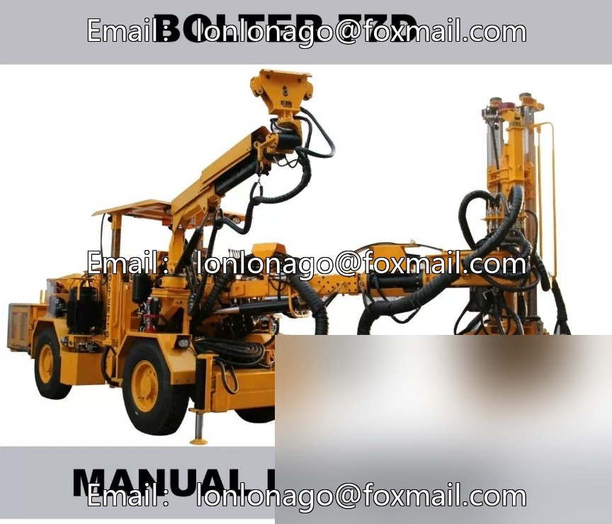
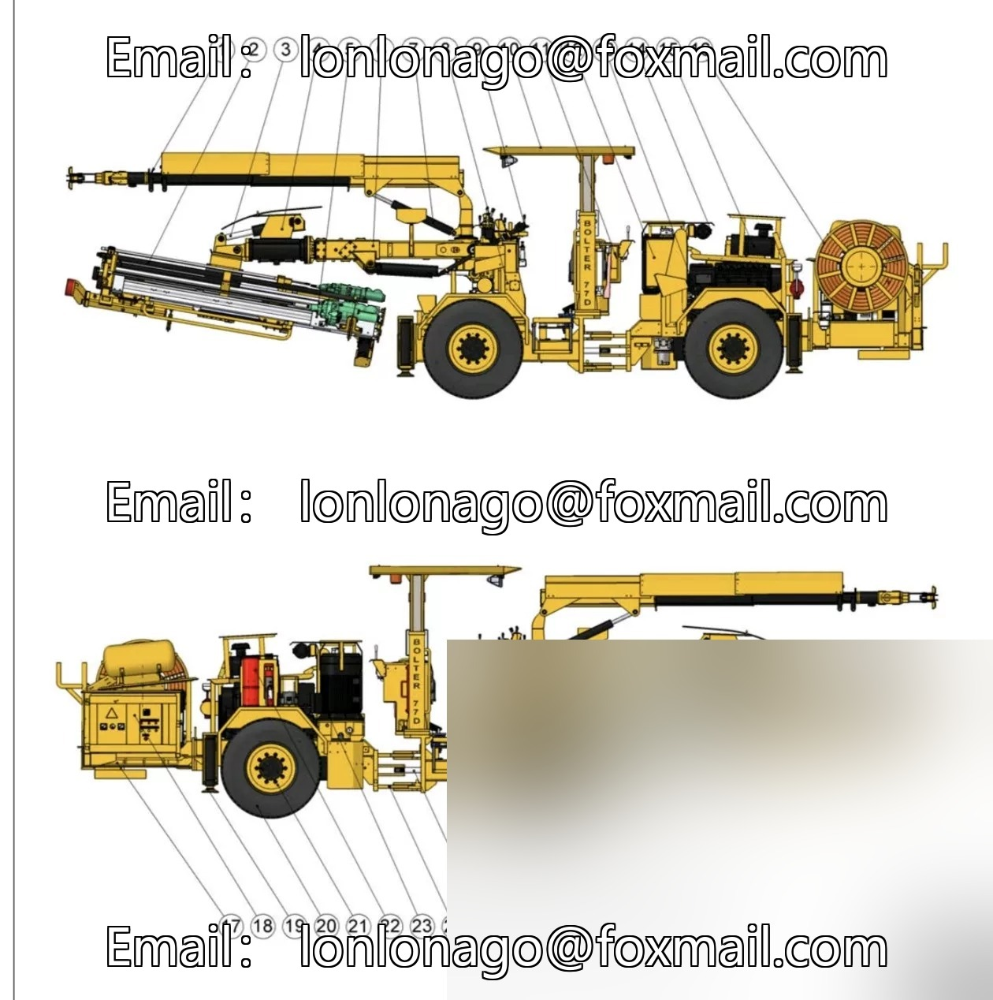
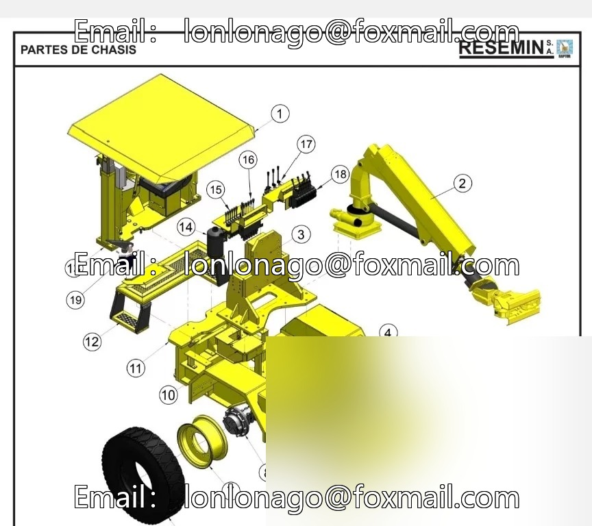
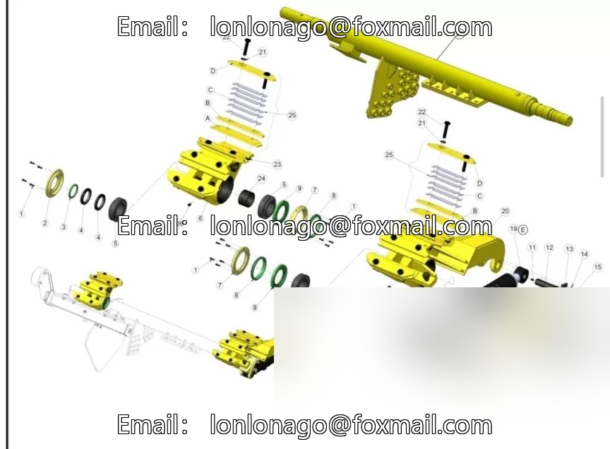
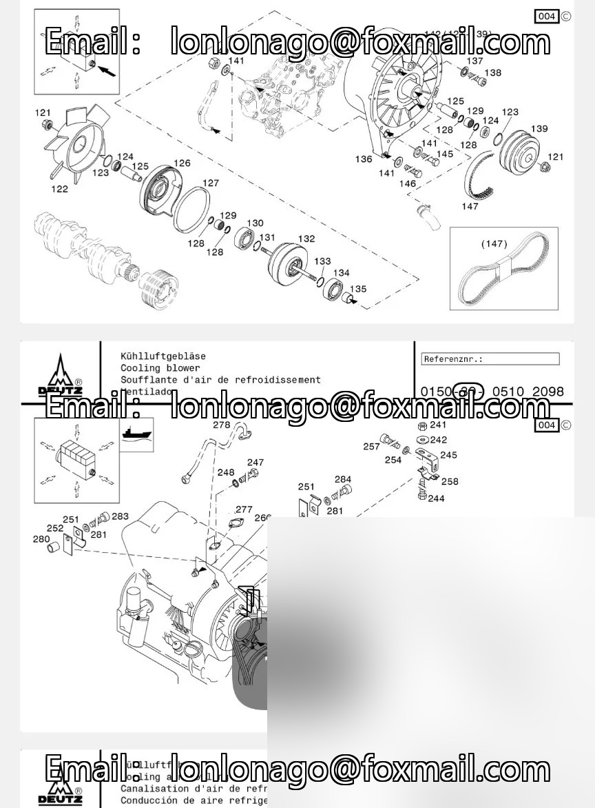

# Bolter 77D mining equipment part manual (Manual de P)

## Body

Bolter 77D mining equipment parts manual (PDF ), 410 pages, including detailed structural drawings and part list, suitable for reference in equipment maintenance and spare parts procurement.
915-man

This manual covers Bolter 77D mining equipment parts in PDF format with 410 pages, offering detailed structural diagrams and a component list for maintenance and spare parts procurement reference.

<!-- AI_ENRICHED -->

## Images

## Payment

Here is a pay link on Stripe ( https://buy.stripe.com/3cs8yP7sY87d0vu9AB ). Please contact me lonlonago@foxmail.com after funding $89, and I will send you a complete data files , thank you!

